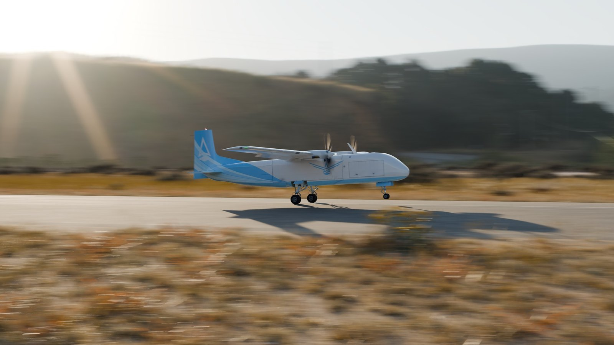
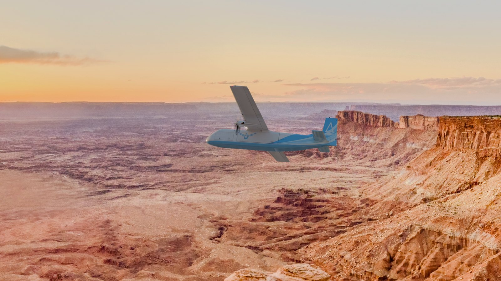
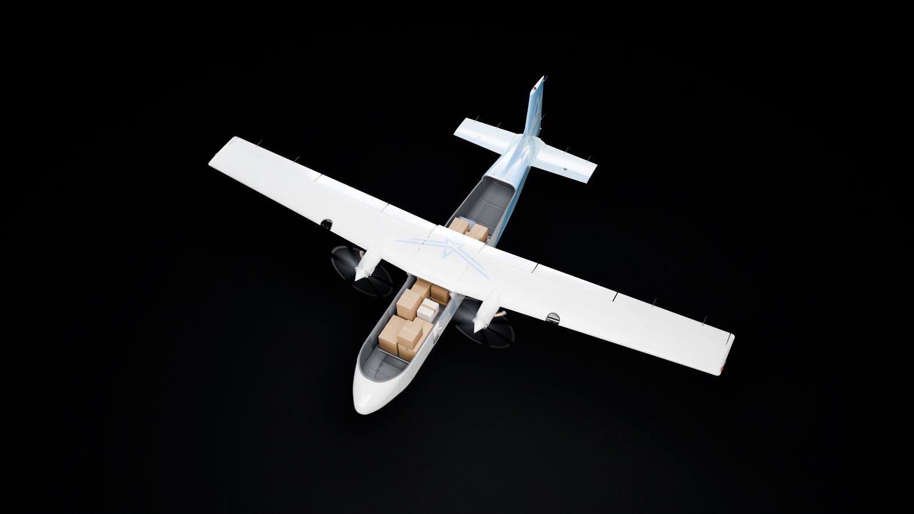
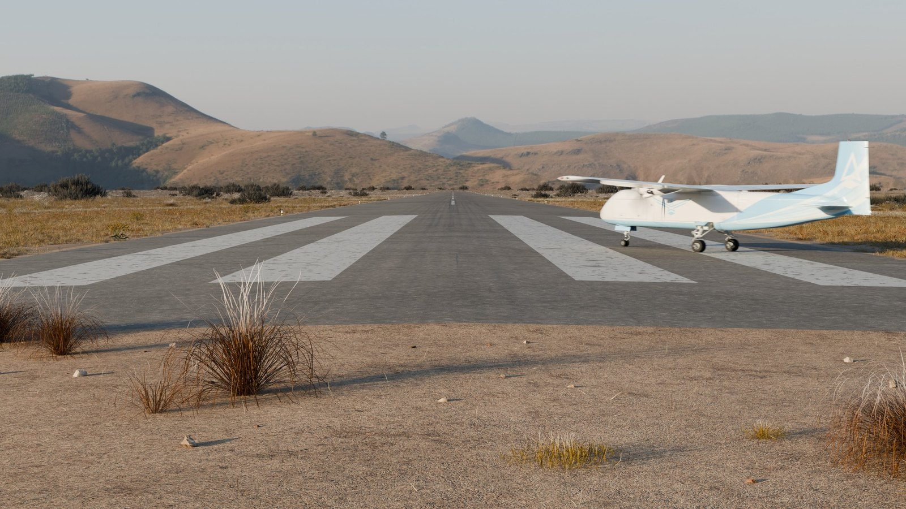
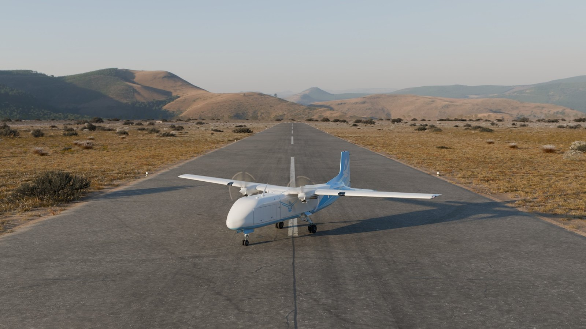
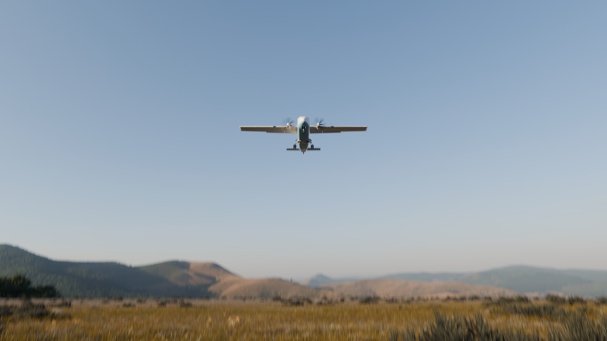
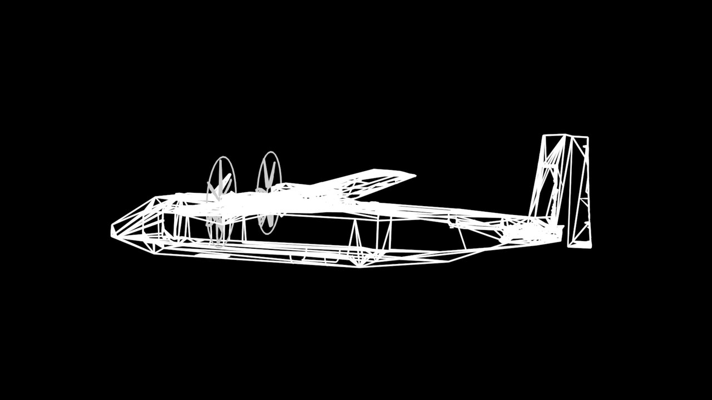
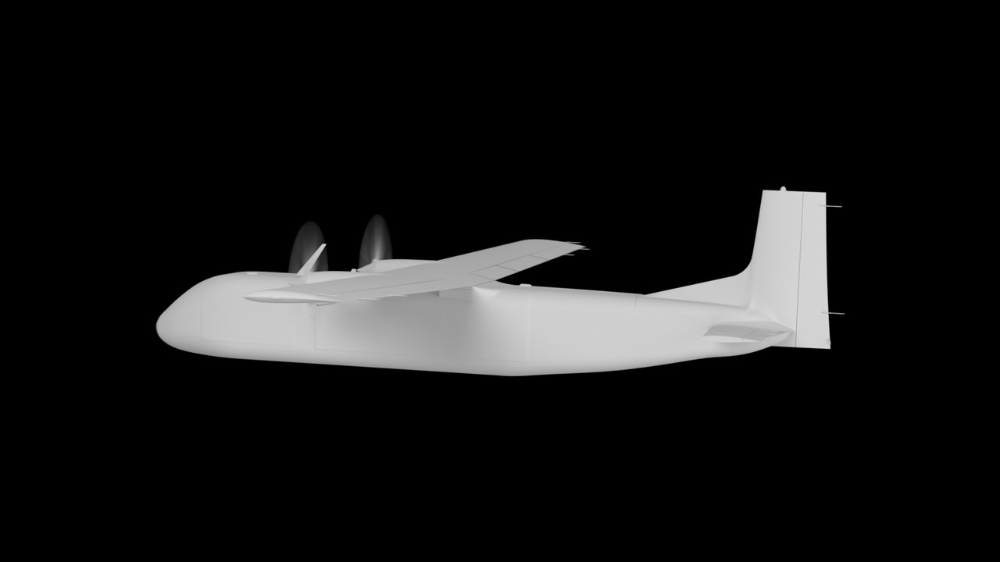
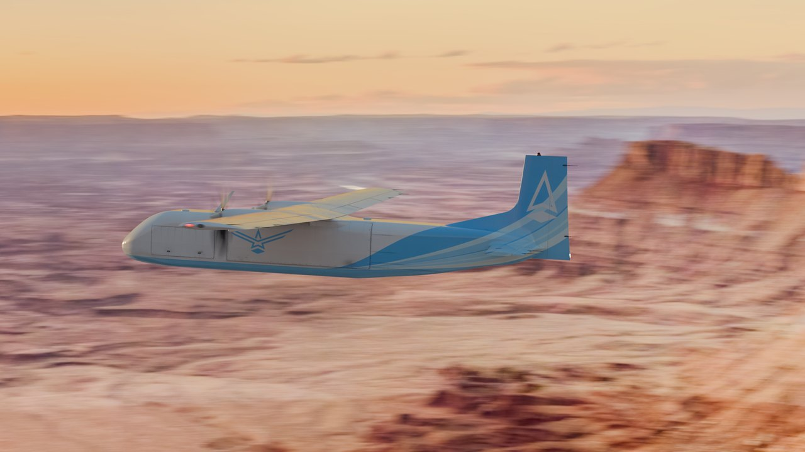

<!-- Aviern CG field guide v001 (2026-10-26), aviern.com. -->
<p align="center">
  <a href="https://aviern.com"></a>
</p>

<p align="center">
  
  
  
  
</p>

A field guide for making film-quality CG of a physical product with AI coding agents (Claude Code, Codex, or similar), a 3D
renderer and rented or local GPUs. It is written to be handed to an agent as-is: the agent checks your setup, asks one round of
questions, maps each step onto your tools, and scaffolds the project. It stops before any spending, upload of product data or
outside contact until you approve that action.

The process and its figures come from a real production: 16 photoreal and stylised 4K shots of Aviern's unmanned cargo aircraft
for a launch video, made in October 2026 with Claude Code, Codex, Blender and cloud GPUs.

## Rendered with this process

Final frames from that production: 3840x2160 at 24 fps, rendered in Blender Cycles on cloud GPUs and finished with the scripts in
this repository. No frame was retouched.

<table>
  <tr>
    <td width="50%"><br><b>Takeoff, gear retracting.</b> A fully 3D airfield joined to a 360° photo panorama.</td>
    <td width="50%"><br><b>Landing rollout into a low sun.</b> Photoscanned plants, scanned asphalt.</td>
  </tr>
  <tr>
    <td><br><b>Sunset orbit.</b> Lit by an HDRI shot from a drone at altitude, with a sun fitted to the plate.</td>
    <td><br><b>Join-up over a canyon river.</b> A full 3D world built from 1 m lidar and aerial photos.</td>
  </tr>
  <tr>
    <td><br><b>Chase over an autumn forest.</b> Drone HDRI; propellers with a short-exposure camera look.</td>
    <td><br><b>Bank-away exit.</b> The continuation of the sunset orbit.</td>
  </tr>
  <tr>
    <td><br><b>Progressive nose cutaway.</b> A per-pixel cut in every material; cargo vanishes whole as the slice passes.</td>
    <td><br><b>Roof cutaway.</b> Studio void with six softboxes; also delivered with alpha.</td>
  </tr>
  <tr>
    <td><br><b>Robot-arm loading.</b> Per-frame clearance and motion gates before every render.</td>
    <td><br><b>Turning onto the runway.</b> Camera 1.3 m above the centreline; panorama turned so the runway points down a valley.</td>
  </tr>
  <tr>
    <td><br><b>Parked orbit.</b> Propellers turning, exterior lights flashing.</td>
    <td><br><b>Final approach overhead.</b> The shot ends on open sky.</td>
  </tr>
</table>

Measured at 4K on an RTX PRO 6000: in-flight shots 3-6 s per frame, studio cutaways 8-13 s, airfield shots 33-71 s, robot-arm
loading 95-112 s. Section 8 of the guide has the full table and what the project cost.

### One orbit, three looks

<table>
  <tr>
    <td width="33%"><br><b>Wireframe</b></td>
    <td width="33%"><br><b>Clay</b></td>
    <td width="33%"><br><b>Photoreal</b></td>
  </tr>
</table>

The same orbit move delivered in three looks. Motion was agreed once in a wireframe previs before any final rendering (guide
section 4.3). The photoreal panel is a raw scene-linear EXR frame finished with `scripts/finish_look.py` from this repository; it
matches the same frame of the delivered review copy at 40.7 dB PSNR.

## By the numbers

| | Reference production |
|---|---|
| Shots | 16 (19 masters, three with alpha) |
| Final 4K frames | 4,071 |
| Wall clock | 46.7 hours from project setup to checksum-verified delivery |
| Compute | about $2,200-2,330 (GCP Spot and RunPod GPUs) |
| Independent AI reviews | 101 (Claude and Codex) |
| Human 3D artists | 0 |

## Quick start

1. Copy `docs/CG_FIELD_GUIDE.md` into your project folder at the same path (or start from a clone of this repository).
2. Start Claude Code, Codex or another coding agent with shell access in that folder.
3. Send it this:

```text
Read docs/CG_FIELD_GUIDE.md in full, then follow its section A ("For AI agents") for my company. Check what you can on this
machine first, ask me the intake questions in one round, then propose an adaptation plan. Do not create any paid resource, buy
anything, upload our product data anywhere or contact anyone until I approve that specific action.
```

## What is here

| Path | What it is |
|---|---|
| `docs/CG_FIELD_GUIDE.md` | The guide: agent instructions, the 13-stage pipeline, render and colour settings, agent roles, failure modes with guards, measured run times and costs, and paste-ready templates. |
| `scripts/render_shot.py` | Renders a frame range of a Blender scene to half-float EXR, exits non-zero on failure, writes a success marker (guide 4.7). |
| `scripts/finish_look.py` | Applies the project look once to EXR frames, producing 16-bit PNG for encoding; supports alpha and a choice of display (guide 4.9). |
| `assets/` | The images on this page. |

Both scripts, and the ffmpeg encode commands in section 4.9 of the guide, were tested on Blender 5.2.3 and ffmpeg 9.0. Prices,
quotas and model names in the guide are as of October 2026.

---

<p align="center">
  <a href="https://aviern.com">
    <picture>
      <source media="(prefers-color-scheme: dark)" srcset="assets/brand/aviern-mark-white.png">
      
    </picture>
  </a>
  <br>
  <b>Aviern</b> · Nobody on board. · <a href="https://aviern.com">aviern.com</a>
</p>
