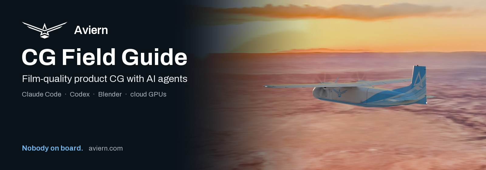
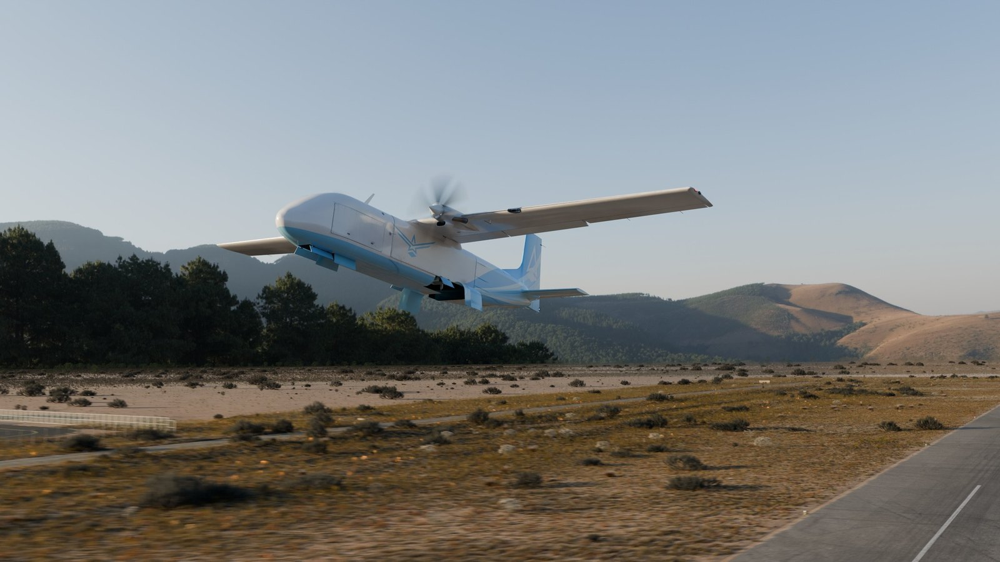
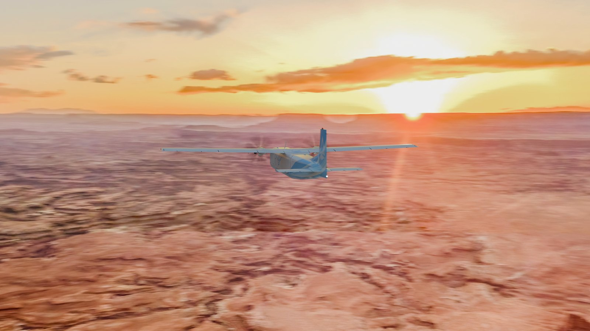
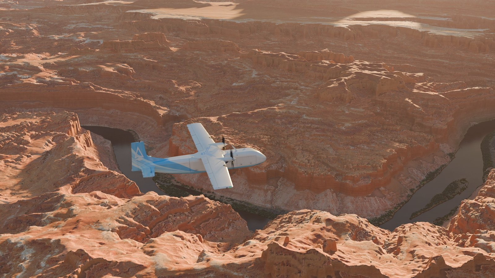
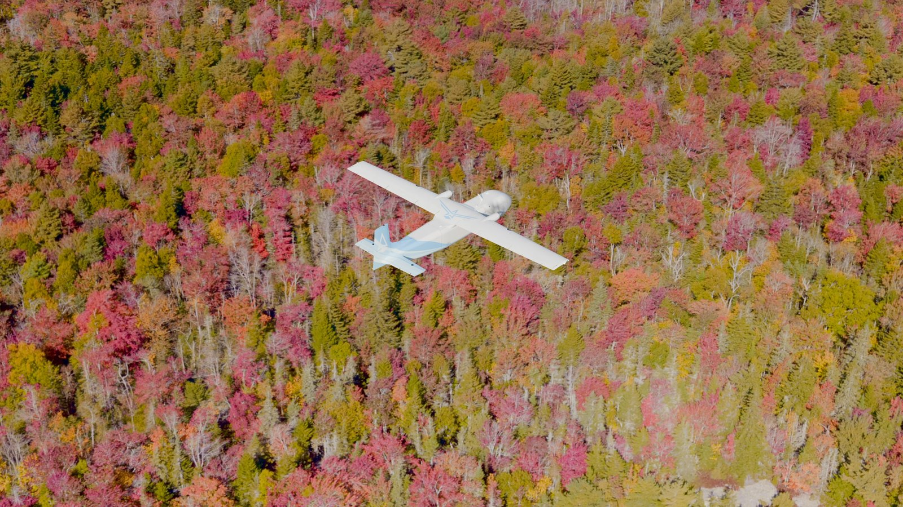
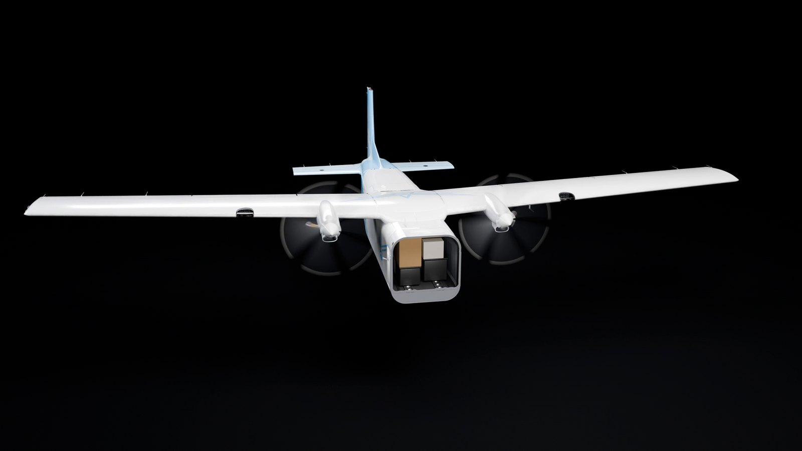

<!-- Aviern CG field guide v001 (2026-10-26), aviern.com. -->
<p align="center">
  <a href="https://aviern.com"></a>
</p>

A guide for making film-quality CG of your product with AI coding agents (Claude Code, Codex or similar), Blender and local or
cloud GPUs. Hand it to an agent: it checks your setup, asks you one round of questions, maps the process onto your tools and sets
up the project, and asks before spending money or sending your files anywhere.

## Scenes built with it

<p align="center">
  <a href="docs/CG_FIELD_GUIDE.md#451-ground-level-outdoor-scene"></a>
  <a href="docs/CG_FIELD_GUIDE.md#452-in-flight-against-a-drone-hdri"></a>
  <a href="docs/CG_FIELD_GUIDE.md#453-terrain-from-elevation-data-and-aerial-photos"></a>
  <a href="docs/CG_FIELD_GUIDE.md#452-in-flight-against-a-drone-hdri"></a>
  <a href="docs/CG_FIELD_GUIDE.md#454-studio-and-cutaway"></a>
  <a href="docs/CG_FIELD_GUIDE.md#455-mechanisms-and-a-loading-dock"></a>
</p>

How each is built, step by step: [airfield](docs/CG_FIELD_GUIDE.md#451-ground-level-outdoor-scene) ·
[flight over a drone HDRI](docs/CG_FIELD_GUIDE.md#452-in-flight-against-a-drone-hdri) ·
[terrain from real data](docs/CG_FIELD_GUIDE.md#453-terrain-from-elevation-data-and-aerial-photos) ·
[studio cutaway](docs/CG_FIELD_GUIDE.md#454-studio-and-cutaway) ·
[loading dock](docs/CG_FIELD_GUIDE.md#455-mechanisms-and-a-loading-dock) ·
[wireframe and clay](docs/CG_FIELD_GUIDE.md#456-wireframe-and-clay)

## Quick start

1. Copy `docs/CG_FIELD_GUIDE.md` into your project at the same path.
2. Open Claude Code or Codex in that folder.
3. Send:

```text
Read docs/CG_FIELD_GUIDE.md in full, then follow its section A ("For AI agents") for my company. Check what you can on this
machine first, ask me the intake questions in one round, then propose an adaptation plan. Do not create any paid resource, buy
anything, upload our product data anywhere or contact anyone until I approve that specific action.
```

## Contents

- `docs/CG_FIELD_GUIDE.md`: the guide.
- `scripts/render_shot.py`: renders a frame range of a Blender scene to EXR.
- `scripts/finish_look.py`: applies the colour look once and writes 16-bit PNGs for encoding.

The scripts are tested on Blender 5.2.3 and ffmpeg 9.0.

---

<p align="center">
  <a href="https://aviern.com">
    <picture>
      <source media="(prefers-color-scheme: dark)" srcset="assets/brand/aviern-mark-white.png">
      
    </picture>
  </a>
  <br>
  <b>Aviern</b> · Nobody on board. · <a href="https://aviern.com">aviern.com</a>
</p>
